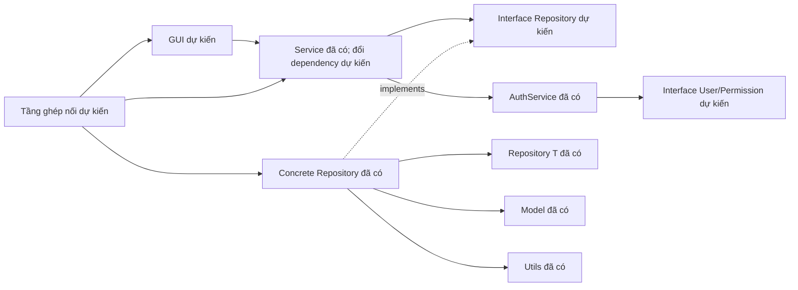

# Cấu trúc thư mục và ranh giới phụ thuộc PBL2

**Trạng thái:** Cây hiện tại được đối chiếu từ repository; phần interface/GUI/ghép nối là **dự kiến, chưa triển khai**. Xem [thiết kế DIP](dependency_inversion.md), [Permission](PermissionDesign.md) và [hợp đồng GUI–Business](Business_UI_Contract.md).

## 1. Cây hiện tại

```text
PBL2/
├── AGENTS.md
├── README.md
├── data/
│   └── role_permissions.txt
├── src/
│   ├── business/
│   │   ├── AuthService.h/.cpp
│   │   ├── BookingService.h/.cpp
│   │   ├── InvoiceService.h/.cpp
│   │   ├── MemberService.h/.cpp
│   │   ├── MovieService.h/.cpp
│   │   ├── PricingService.h/.cpp
│   │   ├── ReportService.h/.cpp
│   │   ├── RoomService.h/.cpp
│   │   ├── SeatService.h/.cpp
│   │   ├── ShowtimeService.h/.cpp
│   │   └── StaffService.h/.cpp
│   ├── data_access/
│   │   ├── Repository.h
│   │   ├── InvoiceRepository.h/.cpp
│   │   ├── MemberRepository.h/.cpp
│   │   ├── MovieRepository.h/.cpp
│   │   ├── PricingRepository.h/.cpp
│   │   ├── RolePermissionRepository.h/.cpp
│   │   ├── RoomRepository.h/.cpp
│   │   ├── SeatRepository.h/.cpp
│   │   ├── ShowtimeRepository.h/.cpp
│   │   ├── TicketRepository.h/.cpp
│   │   └── UserRepository.h/.cpp
│   ├── data_structures/DoublyLinkedList.h
│   ├── models/                 (Invoice, Member, Movie, Pricing,
│   │                            Room, Seat, Showtime, Ticket, User; .h/.cpp)
│   └── utils/                  (DateTime, FileIO, IdGenerator,
│                                Validator; .h/.cpp)
├── tests/                      (mỗi test có main riêng; có tests/legacy/)
└── docs/
    ├── architecture/           (kiến trúc và hợp đồng thiết kế)
    ├── overview/               (nghiệp vụ và định dạng dữ liệu)
    ├── development/            (kế hoạch, nhiệm vụ, tiến độ)
    └── src/                    (tài liệu code đã kiểm thử)
```

`src/main.cpp`, `src/gui/` và `CMakeLists.txt` **không có trong cây hiện tại**. Các file `data/*.txt` khác không có trong checkout hiện tại; nhiều test tạo dữ liệu tạm. Không suy từ đường dẫn mô tả trong tài liệu cũ rằng file đã tồn tại.

## 2. Cây mục tiêu sau refactor (đề xuất, chờ xác nhận)

```text
src/
├── main.cpp hoặc bootstrap/                 [Dự kiến: tầng ghép nối]
├── gui/                                      [Dự kiến: Qt Widgets]
├── business/                                 [Đã có Service; dự kiến đổi dependency]
├── data_access/
│   ├── IRepository.h                         [Dự kiến: interface lõi tùy chọn]
│   ├── IMovieRepository.h, ISeatRepository.h  [Dự kiến: interface theo domain]
│   ├── ... các interface cần theo consumer    [Dự kiến, chưa chốt tên]
│   ├── Repository.h                          [Đã có: cơ chế lưu trữ]
│   └── *Repository.h/.cpp                    [Đã có: concrete; dự kiến implement interface]
├── models/                                   [Đã có]
├── data_structures/                          [Đã có]
└── utils/                                    [Đã có]
```

Không tạo file rỗng chỉ để khớp cây mục tiêu. Vị trí/tên interface và bootstrap phải được nhóm chốt bằng Markdown trước triển khai.

## 3. Trách nhiệm và hướng phụ thuộc

| Thành phần | Trách nhiệm | Trạng thái |
| --- | --- | --- |
| Model | Trạng thái và quan hệ đối tượng; ID bất biến; link/unlink nhất quán. Không đọc TXT/phân quyền. | Đã có. |
| Interface Repository | Hợp đồng nhu cầu dữ liệu của Service, không giữ file/danh sách/con trỏ sở hữu. Chỉ mô tả thao tác consumer cần. | Dự kiến. |
| `Repository<T>` | Danh sách `T*`, callback parse/serialize/ID, load/save/CRUD cơ bản, giải phóng đối tượng. **Không phải interface.** | Đã có. |
| Concrete Repository | Parse/serialize, CRUD, tham chiếu, link/unlink, ràng buộc dữ liệu và lưu trữ; không cấp quyền người dùng. | Đã có; dự kiến implement interface. |
| Service | Permission, quy tắc nghiệp vụ liên nguồn và điều phối; nhận repository qua interface, không tự tạo concrete. | Đã có; dependency hiện là concrete, cần refactor. |
| GUI | Nhập/hiển thị, gọi Service, dùng `hasPermission()` để bật/tắt UI; không tự quyết định nghiệp vụ hay ghi TXT. | Dự kiến, chưa có `src/gui/`. |
| Utils | Validation, file IO, ngày giờ, ID chung; không quyết định quyền. | Đã có. |
| Tests | Kiểm tra Service, Repository, quyền, dữ liệu và rollback bằng kết quả chạy thật; mỗi test một `main()`. | Đã có; cần bổ sung khi refactor. |



Mũi tên Service → Interface là phụ thuộc biên dịch theo DIP; tầng ghép nối tạo concrete và truyền vào. `AuthService` cũng phải nhận abstraction dữ liệu khi refactor. `RolePermissionRepository` vẫn xử lý bảng `(role, permission)`; Service nghiệp vụ gọi `requirePermission()`. Repository có thể kiểm tra role như **dữ liệu hợp lệ** (ví dụ User/Seller có enum hợp lệ), không dùng role để cấp quyền thao tác.

## 4. Tài liệu và trình tự cập nhật

[Tổng quan](../overview/TongQuanDeTai.md), [quy tắc nghiệp vụ](../overview/business_rules.md), [định dạng dữ liệu](../overview/data_format.md) mô tả mục tiêu; [tiến độ](../development/TongQuanTienDo.md) ghi việc thực hiện. Tài liệu trong [`docs/src/`](../src/) chỉ cập nhật sau khi code tương ứng chạy test thành công. Khi API hoặc schema mâu thuẫn, ghi vấn đề tại thiết kế, chờ nhóm xác nhận rồi **CHỐT MARKDOWN**; không tự sửa code để khớp sơ đồ.

## 5. Chờ nhóm xác nhận

- Tên/vị trí interface, tách lõi và interface theo domain, `const` và kiểu con trỏ; xem [DIP](dependency_inversion.md).
- Tầng ghép nối đặt trong `main.cpp` hay bootstrap; thứ tự nạp/link các repository và vòng đời đối tượng.
- Phạm vi GUI Qt cụ thể, màn hình và file `.ui`; không coi cây GUI cũ là danh sách đã triển khai.
